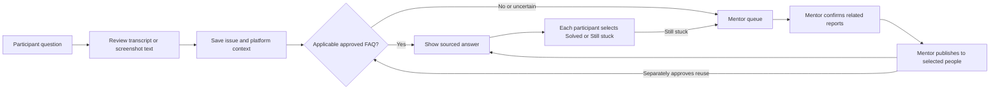

# Unblock

### A multilingual help desk for the Kivi workshop

Participants ask for help by text or voice, optionally attach a screenshot, and see guidance that applies to their platform. Mentors see the questions that still need attention, confirm related reports, answer selected participants together, and learn who is actually unblocked.

Unblock is an independent workshop companion. It does not control Kivi or present itself as an official Kivi or Sarvam support service.

## How it works



An answer is offered only when its approved scope fits the participant's OS, distribution, and version. Sarvam can suggest an existing FAQ or a related group, but cannot write a new fix, approve guidance, or mark someone resolved. The mentor controls publication; each participant controls their own outcome.

### Sarvam in the workflow

| Capability | Purpose | Trigger |
| --- | --- | --- |
| Saaras speech to text | Transcribe a short recording for participant review | Voice processing request |
| Sarvam Vision / Document AI | Extract visible text from a screenshot for review | Screenshot processing request |
| Sarvam 105B | Propose a matching approved FAQ or related issue group | An unstructured question needs classification |
| Bulbul text to speech | Read an approved answer aloud | Participant requests playback |

Clear, known FAQ matches need no model call. Refreshing, viewing a queue, or polling status does not start paid inference.

## Run locally

**Requirements:** Node.js 22.13 or newer, one Node process, and durable local disk. This prototype is intended for one workshop.

```powershell
npm install
node scripts/setup-local.mjs
```

The setup script prepares a private `.env.local` and generates a mentor passcode there. Add your key as `SARVAM_API_KEY`; set `ALLOW_LIVE_API=true` when you intend to use live Sarvam capabilities. Keep the key and passcode out of Git and browser code.

```powershell
npm run build
npm run start
```

Open the [participant page](http://127.0.0.1:3000/w/kivi) and [mentor desk](http://127.0.0.1:3000/mentor). Use another browser profile or private window to try both roles independently. For development, use `npm run dev` instead of build and start.

The repository includes only `.env.example`, with live calls disabled and no credentials.

## What the app includes

- Text requests, microphone capture, audio upload, screenshot preview, transcript and extracted-text review, and on-demand spoken answers.
- Approved FAQ selection without a model call; strictly validated Sarvam classification for unstructured questions.
- Platform/distribution/version-aware matching and honest escalation to a mentor.
- Suggested related reports, mentor-confirmed groups, selected-recipient answers, and independent Solved/Still stuck outcomes.
- Explicit FAQ reuse approval, editing/withdrawal, immutable history, local persistence and private sessions.
- Persistent dispatch budget, authorized private caching, no automatic paid retries, and visible failure states.

The seed knowledge contains five source-reviewed public Mac FAQs. Windows workshop guidance remains unpublished until a mentor verifies and approves it. The Windows installer in this repository is not a source of support instructions.

## Verification

```powershell
npm run typecheck
npm run lint
npm test
npm run build
npm run test:e2e
npm run verify:release
```

The browser suite runs the production build with test-only HTTP interception. Build before running it. Ordinary tests never reach Sarvam. `npm run dev:fixtures` opens the Playwright test UI; production has no fixture mode or fake-response fallback.

For the latest live integration results, commands actually run, and dispatch count, see [PROGRESS.md](PROGRESS.md). Live diagnostics require explicit configuration and opt-in; they never run during install, build, start, or ordinary tests.

An explicit resumable live diagnostic is available:

```powershell
node --env-file-if-exists=.env.local --import tsx scripts/live-smoke.ts --confirm-live
```

This diagnostic resumes ignored private evidence. Direct Node invocation avoids Windows npm wrappers that may drop forwarded flags.

## Deployment and limits

The live dispatch ledger persists across restarts and data resets. Set `LIVE_MAX_DISPATCHES` privately within your approved budget; `.env.example` defaults to six. This is a request limit, not a credit or rupee estimate.

Private app state/uploads live under `.data/app`. The dispatch ledger/cache are separate under `.data/`. Tests and live-validation reports use isolated directories; the release starts without fake participants or metrics. Keys, recordings, screenshots, raw evidence, state and the installer are ignored by Git.

This is a single-workshop, single-process prototype requiring durable local disk. A GitHub-to-Vercel import is **not** a working deployment path for this storage design; hosted deployment requires a different persistent store and a fresh release test. Remote microphone access needs HTTPS. Automated microphone tests use supplied audio and do not establish physical microphone or noisy-room accuracy.

The tool does not provide full accounts, automatic Kivi control, phone calls, external messaging, or a general troubleshooting chatbot. A failed provider request leaves the participant's issue saved for mentor attention.

## Project documents

| Read | For |
| --- | --- |
| [Product requirements](PRD.md) | User flows and acceptance criteria |
| [Architecture](ARCHITECTURE.md) | Components, storage, routes, and security boundaries |
| [Implementation plan](IMPLEMENTATION_PLAN.md) | Sequential build gates |
| [Testing](TESTING.md) | Offline and browser test matrix |
| [AI contracts](docs/AI_CONTRACTS.md) | Model inputs, outputs, and validation rules |
| [Progress and evidence](PROGRESS.md) | Checks actually run and live-dispatch record |
| [Demo guide](docs/DEMO.md) | Walkthrough and release checklist |

See [AGENTS.md](AGENTS.md) before changing application code.
