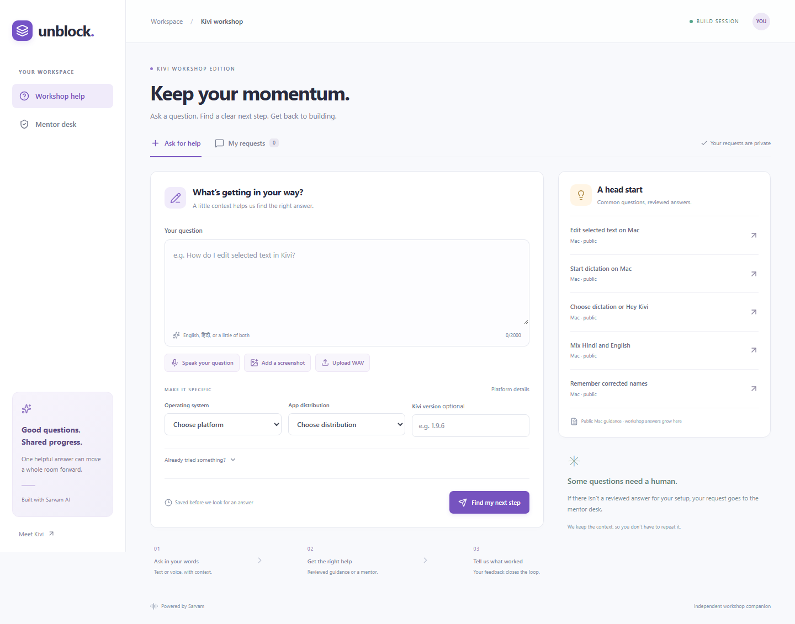
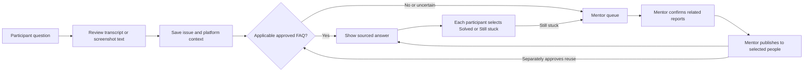
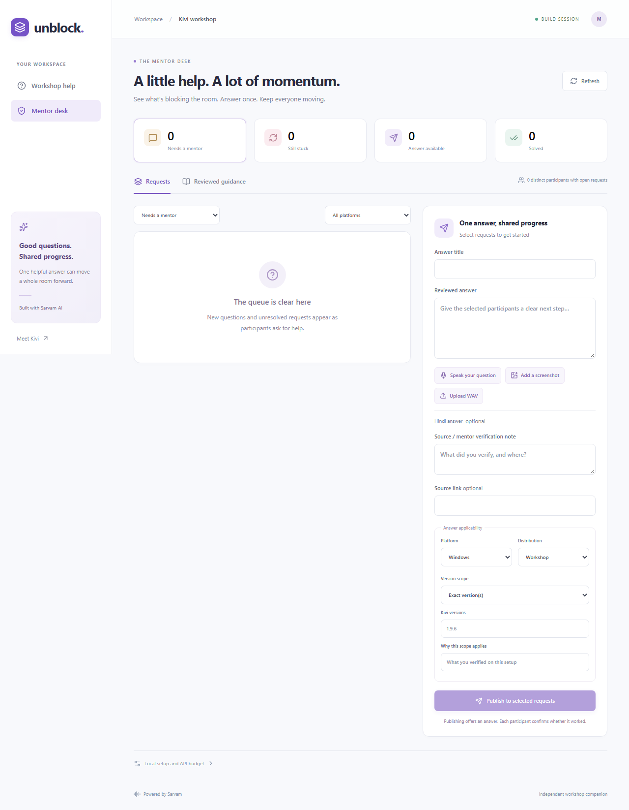

<div align="center">

# Unblock

### Ask once. Help the whole room move forward.

A multilingual workshop help desk built with **Sarvam AI**.<br/>
Voice questions, screenshot context, reviewed answers, and a mentor when you need one.


[Quick start](#run-locally) · [How it works](#how-it-works) · [Screenshots](#screenshots) · [Verification](#verification)

</div>

---

### One mentor. A room full of builders. Nobody should lose momentum waiting for the same answer.

In a one-hour workshop, waiting for help can consume the time you came to spend building. Questions repeat, people explain the same issue in different languages, and a useful answer often reaches only the person who asked.

**Unblock makes each reviewed answer useful to the next person, too.** Ask by voice, add a screenshot, and get guidance that fits your setup. If no approved answer applies, a mentor can review related reports and respond to several people together. Each participant confirms whether it actually worked, so anyone still stuck stays visible.

Built for a **Kivi workshop** with Sarvam’s speech, vision, language, and voice capabilities, Unblock turns workshop support into shared knowledge that grows as the room builds.



## What makes it useful

| For participants | For mentors |
| --- | --- |
| Ask by text, voice, or a mix of Hindi and English | See unanswered questions and failed fixes in one queue |
| Attach a screenshot and review the extracted text | Review related reports before grouping them |
| Get guidance scoped to your platform and version | Answer selected participants together |
| Read an answer or request spoken playback | Explicitly approve answers for future reuse |
| Choose **Solved** or **Still stuck** yourself | Track actual outcomes, independently for each person |

**An answer delivered is not a problem resolved.** One participant can mark an answer solved while another remains in the mentor queue. Reusable guidance requires a separate approval step.

## How it works



Matching respects the participant’s OS, app distribution, and version. The model proposes existing FAQ or group IDs; the server validates them. Mentors publish guidance, and participants confirm their own outcomes.

### Four Sarvam capabilities, one workflow

| Capability | Job in Unblock | When it runs |
| --- | --- | --- |
| **Saaras · speech to text** | Turn a short recording into a reviewable question | Explicit voice processing |
| **Sarvam Vision · Document AI** | Extract visible screenshot text for review | Explicit screenshot processing |
| **Sarvam 105B · language model** | Match an approved FAQ or suggest a related group | Unstructured question classification |
| **Bulbul · text to speech** | Read the approved answer aloud | Requested playback |

Known FAQ selection needs no model call. Page loads, queue refreshes, and ordinary app polling never start inference.

## Screenshots

The participant workspace above is the actual running application, showing a clean workshop session.

<details>
<summary><strong>Open the mentor desk preview</strong> — queues, individual outcomes, and reviewed publishing</summary>

<br/>



</details>

## Run locally

**Requirements:** Node.js 22.13 or newer, one Node process, and durable local disk. This prototype is intended for one workshop.

```powershell
npm install
node scripts/setup-local.mjs
```

The setup script prepares a private `.env.local` and generates a mentor passcode there. Add your key as `SARVAM_API_KEY`; set `ALLOW_LIVE_API=true` when you intend to use live Sarvam capabilities. Keep the key and passcode out of Git and browser code.

```powershell
npm run build
npm run start
```

Open the [participant page](http://127.0.0.1:3000/w/kivi) and [mentor desk](http://127.0.0.1:3000/mentor). Use another browser profile or private window to try both roles independently. For development, use `npm run dev` instead of build and start.

The repository includes only `.env.example`, with live calls disabled and no credentials.

## Verification

```powershell
npm run typecheck
npm run lint
npm test
npm run build
npm run test:e2e
npm run verify:release
```

The browser suite runs the production build with test-only HTTP interception. Build before running it. Ordinary tests never reach Sarvam. `npm run dev:fixtures` opens the Playwright test UI; production has no fixture mode or fake-response fallback.

**Verified:** 27 unit/integration tests, four production-build browser tests, and a successful live pass through ASR, Vision, chat, and TTS. See [PROGRESS.md](PROGRESS.md) for the actual commands, repairs, and dispatch record. Live diagnostics require explicit configuration and opt-in; they never run during install, build, start, or ordinary tests.

An explicit resumable live diagnostic is available:

```powershell
node --env-file-if-exists=.env.local --import tsx scripts/live-smoke.ts --confirm-live
```

This diagnostic resumes ignored private evidence. Direct Node invocation avoids Windows npm wrappers that may drop forwarded flags.

## Scope and deployment

The live dispatch ledger persists across restarts and data resets. Set `LIVE_MAX_DISPATCHES` privately within your approved budget; `.env.example` defaults to six. This is a request limit, not a credit or rupee estimate.

Private app state/uploads live under `.data/app`. The dispatch ledger/cache are separate under `.data/`. Tests and live-validation reports use isolated directories; the release starts without fake participants or metrics. Keys, recordings, screenshots, raw evidence, state and the installer are ignored by Git.

This is a single-workshop, single-process prototype requiring durable local disk. A GitHub-to-Vercel import is **not** a working deployment path for this storage design; hosted deployment requires a different persistent store and a fresh release test. Remote microphone access needs HTTPS. Automated microphone tests use supplied audio and do not establish physical microphone or noisy-room accuracy.

The tool does not provide full accounts, automatic Kivi control, phone calls, external messaging, or a general troubleshooting chatbot. A failed provider request leaves the participant's issue saved for mentor attention.

## Project documents

| Read | For |
| --- | --- |
| [Product requirements](PRD.md) | User flows and acceptance criteria |
| [Architecture](ARCHITECTURE.md) | Components, storage, routes, and security boundaries |
| [Implementation plan](IMPLEMENTATION_PLAN.md) | Sequential build gates |
| [Testing](TESTING.md) | Offline and browser test matrix |
| [AI contracts](docs/AI_CONTRACTS.md) | Model inputs, outputs, and validation rules |
| [Progress and evidence](PROGRESS.md) | Checks actually run and live-dispatch record |
| [Demo guide](docs/DEMO.md) | Walkthrough and release checklist |

See [AGENTS.md](AGENTS.md) before changing application code.

---

<div align="center">

**Good questions. Shared progress.**

An independent Kivi workshop companion built with Sarvam AI.<br/>
Not affiliated with or presented as official Kivi/Sarvam support.

</div>
